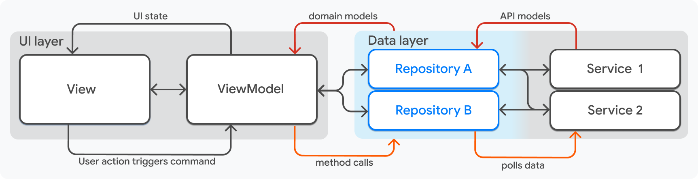

# o_que_comer_app

Projeto Flutter para o app 'O que Comer'.

Configuração, uso e validação do [Firebase e Crashlytics (APP-19)](docs/firebase-crashlytics.md).

## Convenções de Git

### Commits

Este projeto segue o padrão [Conventional Commits](https://www.conventionalcommits.org/pt-br/) (semantic commit). Formato:

Tipos mais usados:

| Tipo       | Quando usar                                              |
|------------|----------------------------------------------------------|
| `feat`     | Nova funcionalidade                                      |
| `fix`      | Correção de bug                                          |
| `docs`     | Alterações apenas em documentação                        |
| `style`    | Formatação, sem mudança de lógica (ex.: `dart format`)   |
| `refactor` | Refatoração sem alterar comportamento                    |
| `perf`     | Melhoria de performance                                  |
| `test`     | Criação ou ajuste de testes                              |
| `build`    | Mudanças no build ou dependências (ex.: `pubspec.yaml`)  |
| `ci`       | Mudanças em pipelines de CI/CD                           |
| `chore`    | Tarefas gerais que não afetam o código de produção       |

Exemplos:

```
feat(login): adiciona autenticação com biometria
fix(cart): corrige cálculo do valor total
refactor(home): extrai widget de card para componente
```


### Branches

O nome da branch deve seguir o padrão:

`[tipo]/APP-[número da task]`


Onde `[tipo]` é um dos tipos de commit listados acima e `[número da task]` é o identificador da task no board.

Exemplos:

```
feat/APP-123
fix/APP-456
refactor/APP-789
```


### Fluxo resumido

1. Crie a branch a partir da `develop` seguindo o padrão acima.
2. Faça commits pequenos e semânticos.
3. Abra o Pull Request referenciando a task (`APP-123`).

## Arquitetura

O projeto segue o padrão MVVM, como recomendado na documentação oficial.

[Guide to architecture](https://docs.flutter.dev/app-architecture/guide)

### Estrutura das pastas

```
|_ lib/
|   |_ ui/ # Parte visual
|   |   |_ core/
|   |   |   |_ themes/ # arquivos de tema
|   |   |   |   |_ colors.dart
|   |   |   |   |_ theme.dart
|   |   |   |_ ui/ # widgets compartilhados
|   |   |_ feature A
|   |   |   |_ view_models/ # Comunicação entre UI e dados
|   |   |   |   |_ feature_a_viewmodel.dart
|   |   |   |_ widgets/
|   |   |   |   |_ feature_a_screen.dart
|   |   |   |   |_ feature_a_widget.dart
|   |_ domain/  # Representação dos dados
|   |   |_ models/
|   |   |   |_ example_model.dart
|   |   |_ use_cases/ 
|   |   |   |_ example_use_case.dart # Usado para combinar repositórios 
|   |_ data/ # Manipulação de dados e apis externas
|   |   |_ repositories/
|   |   |   |_ example_repository.dart
|   |   |_ services/
|   |   |   |_ example_service.dart
|   |   |_ model/
|   |   |   |_ api_model.dart
|   |_ config/ # configurações gerais do app
|   |_ utils/ # Utilitários gerais
|   |_ routing/ # Rotas do app
|   |_ main.dart
|_ test/ # Testes unitários e de widgets
|   |_ data/
|   |_ domain/
|   |_ ui/
|   |_ utils/
|_ testing/ # Mocks e classes necessárias para executar testes
|   |_ fakes/
|   |_ models/
```

### Resumo das camadas
- UI: responsável pelo o que o usuário vê, seja a nível de telas ou componentes (view), consumindo dados por um intermediário (view model)
- Domain: indica como um dado é representado, quais propriedades ele tem. Exemplo: um objeto `Usuário` pode ter nome, email.
- Data: responsável por manipular os dados, sejam recebidos de apis externas ou não, sendo a fonte da verdade, os dados daqui vão para a UI, usando os modelos do Domain.


