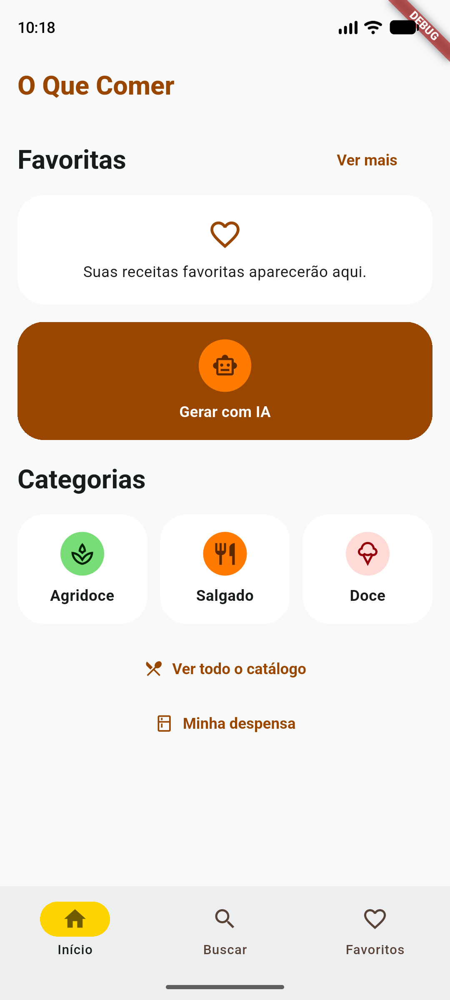
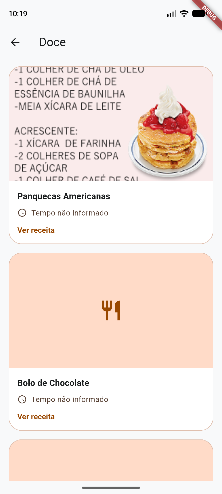

# Selecionar receitas do catálogo — APP-25 / US01

A página inicial segue a referência do card: título do app, prévia das receitas
favoritas existentes, acesso à geração com IA e categorias. Os favoritos são
carregados do repositório já configurado; contas sem favoritos exibem uma
mensagem, sem receitas fictícias.

## Categorias e receitas

`CatalogRepository.getCategories()` descobre todos os valores distintos de
`tipo` ao consultar as páginas do catálogo. A API não tem um endpoint próprio
de categorias; o app não fixa uma lista de categorias na interface. Atualmente
ela retorna `doce`, `salgado` e `agridoce`.

Ao selecionar uma categoria, a navegação abre `/catalogo?categoria=<tipo>`.
`CatalogViewModel` chama `getRecipesByCategory()`, que usa a rota pública
`GET /receitas/tipo/:tipo`. Essa rota retorna um array sem paginação. Respostas
contendo receitas de outra categoria são tratadas como erro de contrato.

Cada card mostra imagem, nome e tempo de preparo. A API atual não fornece tempo:
o modelo compartilha `preparationMinutes: null` e a interface informa
**Tempo não informado**. Um tempo real, quando fornecido ao modelo, aparece em
minutos. A alteração preserva o tempo ausente na serialização dos favoritos e
mantém a validação de tempo obrigatório e positivo para receitas da IA.

Imagens ausentes ou com falha exibem uma alternativa visual sem impedir a
listagem. Selecionar uma receita abre a rota de detalhe existente; a implementação
do conteúdo dessa tela continua pertencendo ao seu próprio card. Voltar do
detalhe preserva a lista e a categoria selecionadas.

## Estado e injeção

- `HomeViewModel` recebe `CatalogRepository` pelo construtor e gerencia as
  categorias da home.
- `CatalogViewModel` recebe o mesmo contrato e a categoria selecionada.
- O router cria as ViewModels com `ChangeNotifierProvider`; o repositório
  continua registrado globalmente pelo `main.dart`.
- As telas mostram carregamento, sucesso, lista vazia ou erro. Lista vazia e
  erro oferecem **Tentar novamente**.
- Respostas antigas não substituem consultas mais recentes. Sair da tela durante
  a consulta não provoca notificação após o descarte da ViewModel.
- O carregamento inicial ocorre após o primeiro frame, inclusive nos favoritos,
  evitando notificações do Provider durante a construção de outra tela.

Não há cache persistente, uso offline, filtros combinados, ordenação ou rolagem
infinita. Descobrir categorias consulta as páginas necessárias sem adicionar um
controle de paginação à interface.

## Como validar

```sh
flutter test test/ui/home/view_models/home_viewmodel_test.dart \
  test/ui/catalog \
  test/data/repositories/api_catalog_repository_test.dart \
  test/routing/router_test.dart
flutter test
flutter analyze --fatal-infos --fatal-warnings
```

Para validar a API real, sem emulador nem credenciais:

```sh
flutter test tool/catalog_smoke_test.dart
```

Para abrir o app em um celular ou emulador, use os arquivos locais já existentes:

```sh
flutter run \
  --dart-define-from-file=config/firebase.local.json \
  --dart-define-from-file=config/gemini.local.json
```

1. Confira as categorias na home e selecione uma delas.
2. Confira o título da categoria e as receitas correspondentes. Selecione uma
   receita e volte para confirmar a preservação da lista.
3. Sem internet, faça uma nova consulta e confira a mensagem explicativa.
   Reconecte e use **Tentar novamente**.
4. Listas vazias, falhas de imagem e consultas pendentes são cobertas pelos
   testes de widgets e repositório, sem depender da disponibilidade da API.

## Capturas da validação local

Capturas no Android em 30/10/2026, com dados reais da API e sem favoritos salvos:

| Página inicial | Categoria Doce |
| --- | --- |
|  |  |

Imagens indisponíveis na API exibem a alternativa visual prevista no app.
